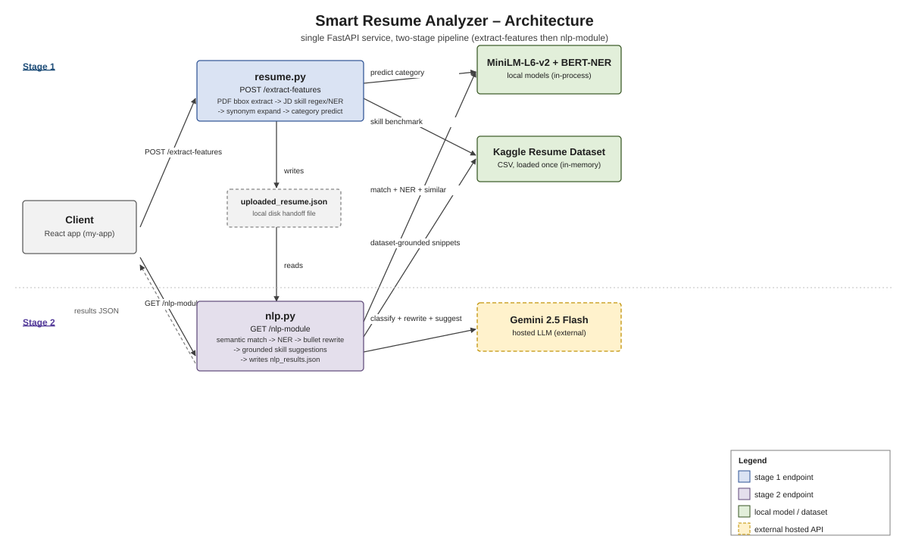

# AI Resume Analyzer

An intelligent resume screening API built with **FastAPI**, **HuggingFace Transformers**, and **Gemini 2.5 Flash**. Upload a PDF resume and a job description — the pipeline semantically matches skills, extracts named entities, rewrites bullet points, and generates grounded, dataset-backed suggestions for missing skills.



A single FastAPI service, deliberately not split into microservices — see [Design decisions](#design-decisions) for why.

---

## Features

- **PDF extraction with bounding-box reconstruction** — uses `pdfplumber`'s word-level bounding boxes to reconstruct complete visual lines before any NLP runs, preventing bullet points from being fed to models as truncated fragments
- **JD skill extraction** — regex-first extraction against a curated tech skill vocabulary, with `dslim/bert-base-NER` as a fallback for proper-noun tools the regex misses; strict blocklisting eliminates BERT subword artifacts
- **Synonym-aware semantic matching** — uses `sentence-transformers/all-MiniLM-L6-v2` to score each extracted requirement against the resume using cosine similarity, with a synonym map that handles aliases (e.g. `kubernetes` → `k8s`, `docker`, `helm`)
- **Category prediction** — embedding-based centroid matching against the Kaggle Resume Dataset predicts the candidate's job category; Gemini confirms or overrides this prediction with reasoning
- **Category alignment bonus** — the resume's embedding is scored against the centroid of real resumes in the predicted category, adding up to 10% to the match percentage for category-appropriate candidates
- **Named entity recognition** — `dslim/bert-base-NER` extracts people, organizations, and locations from the full resume text
- **Bullet point rewriting** — Gemini 2.5 Flash rewrites every detected bullet point; entries where the rewrite is identical to the original are filtered out and never returned
- **Dataset-grounded skill suggestions** — for each missing skill, real lines from same-category resumes in the Kaggle dataset are retrieved and injected into the Gemini prompt, so suggestions reflect how actual candidates in that field describe those skills rather than generic boilerplate; Gemini filters out skills that are not genuinely important for the role

---

## Tech stack

| Layer | Library / Service |
|---|---|
| API framework | FastAPI + Uvicorn |
| PDF extraction | pdfplumber (bounding-box word extraction) |
| Skill extraction | Regex + dslim/bert-base-NER |
| Semantic matching | sentence-transformers (MiniLM-L6-v2) |
| Named entity recognition | Transformers (dslim/bert-base-NER) |
| Category prediction | MiniLM-L6-v2 centroid matching |
| Bullet rewriting | Gemini 2.5 Flash |
| Skill suggestions | Gemini 2.5 Flash + Kaggle Resume Dataset |
| Resume dataset | Kaggle Resume Dataset (CSV) |
| ML backend | PyTorch |

---

## Project structure

```
├── main.py
├── requirements.txt
├── resume.csv                      # Kaggle Resume Dataset
├── .env                            # GEMINI_API_KEY, RESUME_CSV_PATH
└── routes/
    ├── resume.py                   # POST /extract-features — PDF upload + preprocessing
    └── nlp_module.py               # GET  /nlp-module       — full AI analysis pipeline
```

---

## Getting started

### 1. Clone the repo

```bash
git clone https://github.com/your-username/ai-resume-analyzer.git
cd ai-resume-analyzer
```

### 2. Install dependencies

```bash
pip install -r requirements.txt
```

> On first run, HuggingFace will download `all-MiniLM-L6-v2` (~90 MB) and `bert-base-NER` (~420 MB) and cache them at `~/.cache/huggingface/`. Subsequent starts are instant.

### 3. Set environment variables

Create a `.env` file in the project root:

```env
GEMINI_API_KEY=your_gemini_api_key_here
RESUME_CSV_PATH=resume.csv
```

`GEMINI_API_KEY` is required — the bullet rewriting and skill suggestion steps call Gemini 2.5 Flash. Get a key at [aistudio.google.com](https://aistudio.google.com).

`RESUME_CSV_PATH` points to the Kaggle Resume Dataset CSV. The file must contain `resume_str` and `category` columns.

### 4. Run the server

```bash
uvicorn main:app --reload
```

API available at `http://localhost:8000`. Interactive docs at `http://localhost:8000/docs`.

---

## API reference

### `POST /extract-features`

Upload a PDF resume and provide the full job description text. Extracts text using bounding-box reconstruction, pulls skills from the JD, predicts the candidate's job category against the dataset, and stores everything for the analysis step.

**Request** — `multipart/form-data`

| Field | Type | Description |
|---|---|---|
| `file` | PDF | The candidate's resume |
| `requirements` | string | Full job description text (not comma-separated — the full JD) |

**Response**

```json
{
  "message": "Resume processed successfully",
  "pages_extracted": 2,
  "keywords_extracted": ["python", "fastapi", "docker", "postgresql"],
  "requirements_count": 4,
  "predicted_category": "Data Science",
  "top_categories": [
    { "category": "Data Science", "confidence": 0.812 },
    { "category": "Machine Learning", "confidence": 0.743 }
  ],
  "dataset_used": true,
  "benchmark_skills": [
    { "skill": "numpy", "frequency_pct": 68.4 },
    { "skill": "scikit-learn", "frequency_pct": 54.1 }
  ],
  "category_sample_size": 180
}
```

---

### `GET /nlp-module`

Runs the full AI pipeline on the previously uploaded resume. Call this after `/extract-features`.

**Response**

```json
{
  "semantic_match_percentage": 72,
  "adjusted_match_percentage": 79,
  "category_bonus_pct": 7.2,
  "category_bonus_applied": true,
  "matched_requirements": ["python", "fastapi", "postgresql"],
  "unmatched_requirements": ["docker"],
  "per_requirement_scores": {
    "python": 0.89,
    "fastapi": 0.81,
    "postgresql": 0.74,
    "docker": 0.31
  },
  "suitable": true,
  "entities": {
    "PER": ["Riya Sharma"],
    "ORG": ["Google", "IIT Bombay"],
    "LOC": ["Mumbai"]
  },
  "rewritten_bullets": [
    {
      "original": "Worked on improving model performance across multiple projects.",
      "improved": "Boosted ML model accuracy by 18% across 3 production pipelines through systematic hyperparameter tuning, cutting inference latency by 40%."
    }
  ],
  "missing_skill_suggestions": [
    {
      "skill": "docker",
      "suggestion": "Since you already deploy FastAPI services, add a Dockerfile and docker-compose setup to one of your existing projects and describe the containerization in your resume — Data Science candidates in the dataset commonly phrase this as 'Containerized ML inference services using Docker, reducing environment inconsistencies across dev and prod'."
    }
  ],
  "predicted_category": "Data Science",
  "category_reasoning": "The candidate's experience with Python, pandas, and model training aligns most strongly with Data Science.",
  "category_confidence": "high",
  "top_categories": [
    { "category": "Data Science", "confidence": 0.812 }
  ],
  "dataset_used": true,
  "category_alignment_score": 0.721,
  "benchmark_skills": [
    { "skill": "numpy", "frequency_pct": 68.4 }
  ],
  "category_sample_size": 180,
  "similar_resumes": [
    { "similarity": 0.873, "snippet": "Data scientist with 3 years experience in Python, scikit-learn, and NLP…" }
  ]
}
```

**Suitability threshold:** `suitable: true` when `adjusted_match_percentage >= 70`.

---

## Models used

| Model | Size | Purpose |
|---|---|---|
| `sentence-transformers/all-MiniLM-L6-v2` | ~90 MB | Semantic matching + category prediction |
| `dslim/bert-base-NER` | ~420 MB | JD skill extraction (fallback) + NER |
| Gemini 2.5 Flash | API | Bullet rewriting + skill suggestions + category confirmation |

Local models are lazy-loaded once per worker process — the cold-start cost is paid only on the first request.

---

## CPU vs GPU

The pipeline runs on CPU out of the box. If a CUDA GPU is available, PyTorch will use it automatically. For a lighter CPU-only install:

```bash
pip install torch --index-url https://download.pytorch.org/whl/cpu
```

Gemini calls are always remote regardless of hardware.

---

## Design decisions

**Why regex-first, NER-fallback for skill extraction, not NER alone.** A curated regex vocabulary catches known tech terms instantly and precisely — no model inference needed. `dslim/bert-base-NER` only runs afterward, to catch proper-noun tools and products the fixed vocabulary can't anticipate. Running NER alone would be slower on every request and less precise for well-known terms; regex alone would miss anything not already in the list. The blocklist in `resume.py` (`##k`, `##s`, generic words like "experience") exists because BERT's NER genuinely returns subword fragments and generic filler as false-positive "skills" in practice — that list was built from real bad output, not written speculatively.

**Why bounding-box PDF reconstruction instead of `pdfplumber`'s default `extract_text()`.** The default extractor wraps text at the PDF's internal line breaks, so one visual bullet point spanning two lines arrives as two separate, incomplete strings. Both the skill-matching and the Gemini bullet-rewriting steps need a *complete* bullet to work with — a truncated fragment sent to Gemini for rewriting has nothing to actually improve, so it just gets echoed back unchanged. Grouping words by their y-coordinate and reconstructing each line before any NLP touches the text fixes this at the source instead of patching around it downstream.

**Why dataset-grounded prompting instead of asking Gemini directly.** Before asking Gemini to suggest a missing skill, `_extract_skill_context_from_dataset()` first pulls real sentences from same-category resumes in the Kaggle dataset that already mention that skill, and injects them into the prompt as examples. Asking an LLM cold for "how should I add Docker to my resume" gets generic advice ("consider adding Docker experience"). Grounding the prompt in how real candidates in the same category actually phrase it produces suggestions tied to real, specific patterns instead of boilerplate — the same reasoning behind retrieval-augmented generation, applied to career advice instead of Q&A.

**Why local embeddings (MiniLM) for matching, but a hosted model (Gemini) for generation.** Semantic matching, category prediction, and similarity search all run the embedding model repeatedly *within a single request* — once per requirement, once per category centroid, once per candidate resume compared. That volume needs to be fast and free, which is exactly what a small local model gives you. Gemini is called a fixed 3 times per analysis (classify, rewrite bullets, suggest skills) — low enough volume to justify a hosted model that's far more capable at open-ended generation than anything practical to self-host here.

**Why one FastAPI service, not split into microservices.** This is a bounded, sequential pipeline — upload a resume, run analysis, return results — with no bursty async load and no component that needs to scale independently of the others. The [Production RAG Pipeline](https://github.com/maanvi21/production-rag-pipeline) project splits into services because ingestion is bursty and shouldn't block query latency; nothing here has that same pressure. Splitting this into services anyway would add operational complexity (multiple deploys, network calls where function calls suffice) without a real problem it solves.

## Known limitations

- **The handoff between `/extract-features` and `/nlp-module` is a JSON file on local disk** (`uploaded_resume.json`, then `nlp_results.json`), not a database or session store. That means it only works correctly for one user at a time — if two people hit this API concurrently, their requests can clobber each other's intermediate file. Fine for a personal-use demo; would need a real per-request identifier (and a datastore instead of a bare file) to serve multiple users safely.
- **No retry or backoff on the Gemini calls.** A transient failure on any of the three Gemini calls just raises and gets caught by the generic exception handler — no automatic retry. Same honest gap as the RAG pipeline project's Groq calls.
- **No auth.** Anyone who can reach the API can upload a resume and consume Gemini quota.
- **Results aren't persisted anywhere beyond the two local JSON files** (which are gitignored, not committed) — there's no history of past analyses.

---

## License

MIT
